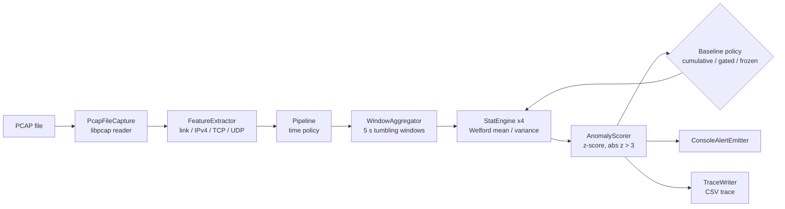

# NetSentinel

A C++17 statistical network anomaly detection system using PCAP processing, Welford's online statistics and
Z-score-based detection.

NetSentinel reads a packet capture, cuts it into 5-second tumbling windows, measures four traffic features per window,
learns a running baseline of each feature with Welford's algorithm, and raises an alert when a window deviates from
that baseline by more than three standard deviations. Every alert lists which features triggered and by how much.

## Problem

Signature-based intrusion detection only recognises attacks it already has rules for, and machine-learning detectors
need labelled training data and are hard to explain. NetSentinel takes the opposite, deliberately simple approach: it
learns what "normal" looks like for the capture it is reading, needs no training data, uses constant memory, and
every decision can be checked by hand from four numbers and a mean and standard deviation. The intended use is
**offline analysis of PCAP files** (forensics, teaching, and a transparent baseline for comparing other detectors). It
does not capture live traffic.

## Features

- PCAP parsing with libpcap: Ethernet (including up to two VLAN tags) and Linux cooked capture; IPv4 with TCP/UDP.
- Four per-window features: packet count, average packet size (on-wire length), unique destination ports, unique
  destination IPs.
- Online mean and variance per feature with **Welford's algorithm** (one pass, constant memory, numerically stable).
- **Z-score** detection: |z| > 3 on any feature raises one alert for the window, after a 20-window warm-up.
- Three **baseline update policies**, selectable at run time:
  - `cumulative` (default): every scored window is learned (the original prototype's behaviour);
  - `gated`: a window that raised an alert is not learned, so an attack does not become "normal"; learning resumes
    after more than 60 consecutive alerting windows so a lasting legitimate change is eventually accepted;
  - `frozen`: thresholds are fixed after warm-up (comparator for the evaluation).
- Optional **SD floor** for the gated baseline: a per-feature minimum standard deviation, so a feature that was constant
  during warm-up can still raise an alert.
- Explicit time and window rules: late packets dropped and counted, isolated far-future timestamps quarantined, long
  idle gaps capped, idle and partial windows reported but never scored or learned.
- Per-window CSV trace (`--trace`) for analysis, distinct exit codes for read errors, and a scripted evaluation toolkit.

## Architecture



| Component | Files | Responsibility |
|---|---|---|
| `PcapFileCapture` | `include/PcapFileCapture.hpp`, `src/PcapFileCapture.cpp` | Opens the file, reads packets, distinguishes clean end of file from read errors |
| `FeatureExtractor` | `src/FeatureExtractor.cpp` | Parses link, IPv4 and transport headers; counts what it cannot parse |
| `Pipeline` | `src/Pipeline.cpp` | Time and window policy; score-then-update; applies the baseline policy |
| `WindowAggregator` | `src/WindowAggregator.cpp` | Builds the four features for each 5-second window |
| `StatEngine` | `src/StatEngine.cpp` | Welford running mean and sample variance for one feature |
| `AnomalyScorer` | `src/AnomalyScorer.cpp` | z-scores, threshold, SD floor, one alert per window |
| `ConsoleAlertEmitter`, `TraceWriter` | `src/ConsoleAlertEmitter.cpp`, `src/TraceWriter.cpp` | Console report and CSV trace |

Interfaces (`include/I*.hpp`) separate the components so each can be tested alone.

## Algorithms

**Welford's online algorithm.** For each new value *x* of a feature, with *n* values seen so far:

```
n     = n + 1
delta = x - mean
mean  = mean + delta / n
M2    = M2 + delta * (x - mean)        # uses the updated mean
variance = M2 / (n - 1)                # sample variance (Bessel's correction)
```

This needs only three numbers per feature, reads the data once, and avoids the catastrophic cancellation of the
naive sum-of-squares formula.

**Z-score.** For a scored window, *z = (x − mean) / sd* per feature, using the baseline learned from earlier windows
(the window is scored first and learned afterwards). If any |z| > 3.0 the window is anomalous. During the first 20
windows nothing is scored. If the variance is below 10⁻⁶ the z-score is undefined and reported as not available, unless
the SD floor is enabled, in which case *sd_effective = max(sd, floor)* with floors 0.5 packets, 2.0 bytes, 0.5 ports and
0.5 IPs.

**Baseline policies.** Exact rules, including the gated baseline's recovery counter, are in
[`docs/EVALUATION_METHODOLOGY.md`](docs/EVALUATION_METHODOLOGY.md) §2.

## Requirements

- CMake ≥ 3.14 and a C++17 compiler (GCC or Clang)
- libpcap with headers (`libpcap-dev` on Debian/Ubuntu; on macOS the system libpcap or `brew install libpcap`) and
  `pkg-config`
- Python 3.8+ for the tests and evaluation tools (standard library only)
- Catch2 v3.5.2 is downloaded automatically by CMake for the unit tests

## Build and test

```bash
cmake -S . -B build -DCMAKE_BUILD_TYPE=Release
cmake --build build -j
cd build && ctest            # 51 tests: unit, golden, oracle, audit-regression, CLI/trace and evaluation-tool tests
```

Optional: `-DNS_SANITIZE=ON` (AddressSanitizer + UndefinedBehaviorSanitizer), `-DNS_STRICT_WARNINGS=ON`.
Full check in a fresh temporary build directory: `bash scripts/verify_repository.sh`.

## Run

```bash
./build/netsentinel data/sample.pcap                          # cumulative baseline (default), every window
./build/netsentinel --quiet data/sample.pcap                  # alerts and summary only
./build/netsentinel --policy gated --sd-floor --trace run.csv capture.pcap
./build/netsentinel --help
```

| Option | Meaning |
|---|---|
| `--policy cumulative\|gated\|frozen` | Baseline update policy (default `cumulative`). The older names `b0` and `b1` are still accepted |
| `--recovery N` | Gated baseline: learning resumes after N consecutive alerting windows (default 60) |
| `--sd-floor`, `--floor-values a,b,c,d` | Gated baseline only: per-feature minimum standard deviation (default 0.5, 2.0, 0.5, 0.5) |
| `--threshold T` | Absolute z-score threshold (default 3.0) |
| `--gap-cap SEC` | Idle-gap cap and far-future-timestamp threshold in seconds (default 60) |
| `--trace PATH` | Write a per-window CSV trace (`netsentinel-trace-v1`) |
| `--quiet` | Print only alerts and the run summary |

Exit codes: 0 success; 1 cannot open the file or unsupported link type; 2 PCAP read error (results incomplete);
64 invalid command line.

### Example output

`./build/netsentinel --quiet data/sample.pcap` on the included 717-packet sample, which contains one scripted scan
burst in window 25:

```
NetSentinel -- Statistical Anomaly Detection Pipeline
Reading: data/sample.pcap

Window 25 [1125.0s - 1130.0s)
  !! ANOMALY  window [1125.0s, 1130.0s)
       - packet_count: observed=150  z=90.067
       - avg_packet_size: observed=54  z=-21.113
       - unique_dst_ports: observed=50  z=93.194
       - unique_dst_ips: observed=20  z=19.081

--- Run summary ---
Packets read from PCAP:                 717
Packets parsed (IPv4):                  714
Packets skipped (unparseable/non-IPv4):  3
  of which IPv6:                        0
  of which other ethertype:             2
  of which malformed IPv4:              0
  of which truncated link header:       1
Late packets dropped:                   0
Far-future packets quarantined:         0
Idle gaps capped (60 s rule):           0
Windows emitted:                        30
  scored:                               29
  idle (not scored/learned):            0
  no parsed traffic (not scored/learned): 0
  partial final (not scored/learned):   1
Alerts raised:                           1
```

## Evaluation

**CICIDS2017, Friday working hours** (9,997,874 packets; corrected flow labels of Engelen et al. 2021), run on macOS
on 1 Nov 2026. Window-level metrics, mixed windows excluded; parameters are the untuned defaults:

| Configuration | Precision | Recall | F1 | False alarms / hour |
|---|---|---|---|---|
| `original_prototype` (historical reference) | 0.262 | 0.161 | 0.199 | 23.2 |
| `cumulative` | 0.274 | 0.158 | 0.200 | 21.7 |
| `gated` | 0.287 | 0.888 | 0.434 | 114.0 |
| `gated_sd_floor` | 0.287 | 0.888 | 0.434 | 114.0 |
| `frozen` (comparator) | 0.079 | 0.988 | 0.146 | 596.4 |
| `gated_sd_floor_recovery12` (sensitivity) | 0.173 | 0.258 | 0.207 | 64.0 |

The gated baseline raises recall from 0.16 to 0.89 at about five times the false-alarm rate. The SD floor changed no
decision on this capture. On that Mac each NetSentinel configuration processed 1.3–1.4 million packets per second with a peak memory below 2 MB. This is
one day of one dataset at window level; the numbers are not comparable with flow-level results in the literature.

- Evidence and every raw file: [`docs/evidence/friday_macos_2026-11-01/`](docs/evidence/friday_macos_2026-11-01/).
  Those files use the earlier configuration names (`r0_raw`, `b0`, `b1_nofloor`, `b1_floor`, `frozen`,
  `b1_floor_r12`), in the same order as the table above.
- The evaluation was run with the **evaluation version**, commit `09d6269`. Later commits changed names, messages, comments
  and documentation only; outputs were checked to be identical apart from the policy name (see `docs/CHANGES.md`). The
  CICIDS2017 evaluation itself was not re-run on later commits.
- Methodology (label-to-window mapping, metrics, exclusions): [`docs/EVALUATION_METHODOLOGY.md`](docs/EVALUATION_METHODOLOGY.md).
- Reproduce: [`docs/CICIDS2017_FRIDAY_RUNBOOK.md`](docs/CICIDS2017_FRIDAY_RUNBOOK.md) (one command: `tools/eval/run_friday.sh`).
  The dataset (about 8.7 GB) is not included; download it from the sources in the runbook.
- Supplementary synthetic scenarios (Linux): [`docs/evidence/synthetic_scenarios_linux.md`](docs/evidence/synthetic_scenarios_linux.md);
  SD-floor selection: [`docs/evidence/floor_sweep/floor_sweep.md`](docs/evidence/floor_sweep/floor_sweep.md).

## Verification status

| Platform | What was run | Version | Record |
|---|---|---|---|
| Linux (x86-64, GCC 13.3, system libpcap) | Release build and `ctest` 51/51; ASan + UBSan + strict-warnings build and `ctest` 51/51, 0 warnings; mutation and fixture checks | evaluation version (`09d6269`) | `docs/evidence/verification_linux_09d6269.txt` |
| Linux | Synthetic scenario comparison; SD-floor sweep | comparison: binary identical to the evaluation version's Release build; sweep: development build of 31 Oct 2026 | `docs/evidence/synthetic_scenarios_linux.md`, `docs/evidence/floor_sweep/` |
| macOS (26.7.1, arm64, system libpcap) | Release build and `ctest` 51/51; `sample.pcap` 30 windows, 1 alert; CICIDS2017 Friday evaluation | evaluation version (`09d6269`) | `docs/evidence/friday_macos_2026-11-01/` |
| Linux | After the terminology change: Release and ASan + UBSan `ctest` 51/51; 25 test captures × 6 configurations give identical output before and after, apart from the policy name | final project version | `docs/CHANGES.md` |

## Repository layout

```
include/, src/          detector (C++17)
tests/                  unit (Catch2), golden, oracle, audit-regression, CLI/trace and evaluation-tool tests; fixtures
tools/eval/             label alignment, window labelling, metrics, comparison runner, Friday script
tools/experiments/      SD-floor selection experiment
scripts/                verify_repository.sh (fresh build + full test run)
data/sample.pcap        717-packet sample capture (generate_sample_pcap.py reproduces it)
docs/                   changes, methodology, runbook, glossary, mutation results, provenance, evidence
MANIFEST.sha256, source_inventory.txt   provenance records of the original prototype (historical, see docs/PROVENANCE.md)
```

## Documentation

| Document | Content |
|---|---|
| [`docs/CHANGES.md`](docs/CHANGES.md) | What changed from the original prototype, each defect and its closing test |
| [`docs/EVALUATION_METHODOLOGY.md`](docs/EVALUATION_METHODOLOGY.md) | Configurations, label mapping, metrics, exclusions, rules fixed before the results |
| [`docs/CICIDS2017_FRIDAY_RUNBOOK.md`](docs/CICIDS2017_FRIDAY_RUNBOOK.md) | Step-by-step reproduction of the CICIDS2017 evaluation |
| [`docs/GLOSSARY.md`](docs/GLOSSARY.md) | Terms, and the short development labels used in commit messages, tags and older evidence files |
| [`docs/MUTATION_RESULTS.md`](docs/MUTATION_RESULTS.md) | Deliberately injected bugs and whether the tests caught them |
| [`tests/README.md`](tests/README.md) | What each test group checks |

## Versions

This public repository is a single snapshot of the final project version (tag `v1.0.0`). The project was developed in
a separate development repository that keeps the full commit history. Commit hashes cited in the documentation refer
to that development repository; its history is available on request.

| Version | Development-repository commit |
|---|---|
| Original prototype (starting point, kept unchanged for comparison) | `f0e39c0` |
| Evaluation version (produced the CICIDS2017 results above) | `09d6269` |
| Final project version (this repository, tag `v1.0.0`) | snapshot of the final development commit |

Development commit messages use short internal labels; [`docs/GLOSSARY.md`](docs/GLOSSARY.md) explains them.


## Limitations

- Offline PCAP analysis only; no live capture.
- Only IPv4 is analysed; IPv6 and other traffic are counted as skipped.
- The false-alarm rate depends on traffic shape; the default threshold, window length and warm-up were not tuned.
- Slow, gradual change is detected only partly (synthetic +2 %/window ramp: 33 % of ramp windows flagged by the
  cumulative baseline, 81 % by the gated baseline).
- The cumulative baseline gradually learns an attack it keeps seeing; the gated baseline can lock out a legitimate
  change for up to 60 windows (716 of its 725 CICIDS2017 false alarms occurred while it was refusing to learn) and can
  absorb a very long attack after recovery.
- The 5-second window and 20-window warm-up are compile-time constants.
- Evaluated on one day of one public dataset. No novelty is claimed.

Full list with evidence: [`docs/CHANGES.md`](docs/CHANGES.md).

## Future work

- Live capture from a network interface (libpcap already supports it; the capture layer is behind an interface).
- IPv6 support.
- Configurable window length and warm-up.
- Additional features (for example entropy of destination ports and addresses) and a calibrated threshold.
- Alternative baselines (sliding window, exponentially weighted) compared under the same methodology.
- Evaluation on more days and more datasets.

## References

1. B. P. Welford, "Note on a method for calculating corrected sums of squares and products," *Technometrics*, vol. 4,
   no. 3, pp. 419–420, 1962. https://doi.org/10.1080/00401706.1962.10490022
2. I. Sharafaldin, A. H. Lashkari, A. A. Ghorbani, "Toward Generating a New Intrusion Detection Dataset and Intrusion
   Traffic Characterization," in *Proc. 4th Int. Conf. on Information Systems Security and Privacy (ICISSP)*, 2018,
   pp. 108–116. https://doi.org/10.5220/0006639801080116
3. G. Engelen, V. Rimmer, W. Joosen, "Troubleshooting an Intrusion Detection Dataset: the CICIDS2017 Case Study," in
   *2021 IEEE Security and Privacy Workshops (SPW)*, 2021. https://doi.org/10.1109/SPW53761.2021.00009

## License

No license has been chosen yet. Until one is added, the code is published for viewing only and no reuse rights are
granted.
